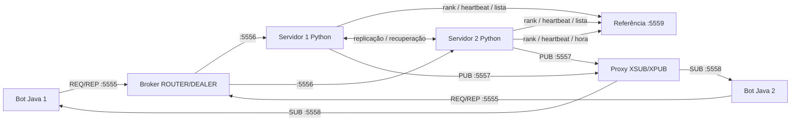

# FEI – Sistemas Distribuídos: sistema de troca de mensagens instantâneas

Projeto da disciplina de Sistemas Distribuídos. O sistema implementa bots que fazem login, criam/listam canais e publicam mensagens, com comunicação ZeroMQ, serialização binária MessagePack e persistência SQLite. Esta versão contempla as Partes 1 a 5, incluindo eleição de coordenador, sincronização Berkeley e replicação completa das mensagens entre os servidores.

## Execução

```bash
docker compose up --build
```

O Compose inicia um broker, um proxy Pub/Sub, um serviço de referência, dois servidores Python e dois bots Java. Para encerrar, use `Ctrl+C` e `docker compose down`.

Os bancos SQLite permanecem em `data/server-1/` e `data/server-2/`, em volumes separados. As mensagens publicadas são replicadas entre os servidores. Para reiniciar os dados do zero, pare os containers e remova essas pastas.

## Arquitetura



| Serviço | Função |
|---|---|
| `broker` | Encaminha requisições dos bots para os servidores usando ROUTER/DEALER. |
| `proxy` | Encaminha publicações dos servidores aos clientes inscritos, usando XSUB/XPUB. |
| `reference` | Atribui ranks, mantém a lista de servidores disponíveis e recebe heartbeats; não fornece mais o horário físico. |
| `server-1` e `server-2` | Processam login, canais e publicações; mantêm bancos SQLite locais e replicam entre si todas as mensagens publicadas. |
| `client-1` e `client-2` | Bots Java que fazem login, assinam canais e publicam mensagens continuamente. |

## Linguagens e bibliotecas

- **Python 3.12:** broker, proxy, servidores, serviço de referência e cliente Python de referência.
- **Java 21:** bots executados pelo Compose, usando JeroMQ.
- **ZeroMQ:** padrões REQ/REP, ROUTER/DEALER e PUB/SUB.
- **MessagePack:** serialização binária interoperável entre Java e Python.
- **SQLite:** persistência independente por servidor.

O broker e o proxy não interpretam nem alteram os envelopes; apenas encaminham os frames, preservando a comunicação binária.

## Formato das mensagens – MessagePack

Todas as mensagens de aplicação usam o mesmo envelope MessagePack:

| Campo | Tipo | Significado |
|---|---|---|
| `service` | string | Operação solicitada (`login`, `channel`, `channels`, `publish`, `rank`, `list`, `heartbeat` etc.). |
| `timestamp` | número | Timestamp físico de envio, em segundos desde Unix epoch. |
| `logical_clock` | inteiro | Contador lógico de Lamport do processo remetente. |
| `data` | mapa | Dados específicos da operação. |

Nas publicações PUB/SUB, o primeiro frame é o tópico UTF-8 (nome do canal) e o segundo frame é o envelope MessagePack com os mesmos campos obrigatórios.

### Relógio lógico (Lamport)

Cada bot e cada servidor inicia seu contador em zero. Antes de enviar uma mensagem, incrementa o contador e inclui o novo valor em `logical_clock`. Ao receber uma mensagem, atualiza seu contador para `max(contador_local, contador_recebido)`, conforme a regra definida no enunciado. A regra é aplicada tanto às mensagens REQ/REP quanto às publicações recebidas/enviadas e às mensagens trocadas com o serviço de referência.

O contador do bot Java é sincronizado entre a thread principal (REQ/REP) e a thread que recebe publicações SUB. O cliente Python também mantém um contador compartilhado entre essas operações.

## Serviço de referência, ranks e heartbeat

O novo container `reference` atende na porta TCP `5559` e usa o mesmo envelope MessagePack.

| Serviço | Requisição (`data`) | Resposta (`data`) |
|---|---|---|
| `rank` | `{name}` | `{status, rank}` |
| `list` | `{}` | `{status, servers:[{name, rank}, ...]}` |
| `heartbeat` | `{name, rank}` | `{status, servers:[...]}` |

Ao iniciar, cada servidor envia `rank` com seu nome. A referência atribui um inteiro sequencial e não cria outro registro para um nome já conhecido. O rank é estável durante a execução do serviço de referência.

A cada 10 requisições recebidas de clientes, o servidor envia um `heartbeat`. A referência atualiza o instante de último contato e devolve o status e a lista de servidores disponíveis. A sincronização do relógio físico é feita pelo coordenador eleito, usando o algoritmo Berkeley e um **offset físico interno**; os containers não precisam alterar o relógio do sistema operacional.

A lista de disponíveis contém somente servidores que enviaram heartbeat dentro do timeout configurado (`HEARTBEAT_TIMEOUT`, padrão de 30 segundos). Servidores expirados são removidos da lista de disponíveis; o registro do nome/rank é mantido para que o rank não seja reutilizado. O serviço `list` retorna os nomes e ranks atualmente disponíveis. Na Parte 4, a referência não fornece mais o horário no heartbeat; a sincronização física é realizada pelo coordenador usando Berkeley.

> O heartbeat é disparado pela contagem de requisições de clientes, conforme solicitado. Portanto, se um servidor ficar sem receber requisições, ele não envia heartbeat nesse intervalo e poderá expirar da lista de disponíveis.

## Parte 1 – login e canais

- `login`: valida usuário (1–32 caracteres alfanuméricos, `_`, `-` ou `.`) e registra o timestamp no SQLite.
- `channel`: cria canais com nomes de 1–32 caracteres minúsculos, números, `_` ou `-`; duplicatas são rejeitadas.
- `channels`: retorna os nomes dos canais registrados naquele servidor.
- Cada servidor mantém seu banco próprio em `data/<nome-do-servidor>/`.

## Parte 2 – publicação e inscrição

O cliente pode assinar múltiplos tópicos no socket SUB. O servidor recebe `publish`, persiste a mensagem e publica no tópico igual ao nome do canal. A publicação inclui o usuário, o texto, o servidor, o timestamp original do cliente e o relógio lógico do cliente. O bot imprime canal, mensagem, timestamp de envio e timestamp de recebimento.

Os bots mantêm o comportamento automatizado do enunciado: garantem pelo menos cinco canais (criando um quando necessário), fazem inscrição até três canais e publicam em lotes de dez mensagens com intervalo de um segundo.

## Persistência

Cada servidor mantém um arquivo SQLite separado com as tabelas:

- `logins`: usuário e timestamp do login;
- `canais`: nome, criador e timestamp de criação;
- `mensagens`: canal, usuário, texto, timestamp de envio do cliente e timestamp de publicação do servidor. A coluna `replication_id` identifica globalmente cada publicação e evita duplicatas entre réplicas.

## Parte 5 – consistência e replicação

### Método escolhido: replicação ativa por disseminação (push) com anti-entropia (pull)

O projeto usa replicação completa entre os servidores. Cada servidor continua recebendo requisições do broker em round-robin, mas, quando recebe uma publicação válida, grava a mensagem no seu SQLite local e envia uma requisição ponto a ponto aos demais servidores configurados em `PEER_ADDRESSES`. Essa comunicação usa ZeroMQ REQ/REP e o mesmo envelope MessagePack das demais mensagens internas. O broker e o proxy não precisam conhecer a replicação.

O servidor de origem gera um identificador único (`replication_id`, UUID) para cada mensagem. O servidor receptor grava a mensagem com `INSERT OR IGNORE` e um índice `UNIQUE` nesse identificador. Assim, a mesma publicação pode chegar mais de uma vez sem criar cópias duplicadas. A réplica também garante a existência do canal associado à mensagem. A publicação PUB/SUB destinada aos clientes é feita somente pelo servidor que recebeu originalmente a requisição; a cópia recebida por RPC é persistida, mas não é publicada novamente, evitando ciclos e notificações duplicadas.

Para recuperar mensagens que não puderam ser enviadas porque um servidor estava desligado ou indisponível, foi adicionada uma etapa de anti-entropia: ao iniciar, cada servidor solicita aos pares o histórico de mensagens e insere apenas os identificadores que ainda não possui. Enquanto estiver em execução, repete essa comparação periodicamente (a cada 30 segundos). Portanto, a propagação normal é por *push* no momento da publicação e a recuperação de divergências é por *pull* periódico e na inicialização.

A implementação foi adaptada ao projeto de duas formas: (1) a replicação usa o canal ponto a ponto já criado na Parte 4 para eleição e sincronização de relógio, sem alterar broker, proxy ou clientes; (2) como cada servidor possui um arquivo SQLite independente, a tabela `mensagens` recebeu `replication_id` e uma migração automática para bancos antigos, preservando as mensagens já armazenadas. A operação de inserção é idempotente, o que permite repetir a sincronização sem duplicar o histórico.

A garantia prática é de convergência: com os servidores novamente acessíveis e a comunicação restabelecida, as mensagens persistidas em qualquer réplica são copiadas para as demais. Durante uma indisponibilidade, uma publicação pode ficar temporariamente presente apenas no servidor que a recebeu; a anti-entropia corrige essa diferença quando os pares voltam a se comunicar. O protocolo não implementa consenso nem transações distribuídas, pois o requisito é manter cópias completas do histórico em todos os servidores, não eleger um único nó de escrita.

### Protocolo interno de replicação

| Ação peer | Dados | Comportamento |
|---|---|---|
| `replicate_message` | `{message: {replication_id, channel, user, message, timestamp_envio, timestamp_pub}}` | Insere uma publicação recebida, ignorando identificadores já existentes. |
| `get_messages` | `{}` | Retorna o histórico local para a sincronização anti-entropia. |

A lista de servidores e seus endereços é configurada em `PEER_ADDRESSES` no `python/server.py`. Para adicionar outro servidor, configure também seu nome, endereço peer e porta de escuta (`PEER_PORT`) no ambiente do container.

### Como validar a replicação

1. Inicie o projeto com `docker compose up --build`.
2. Publique mensagens pelos bots e observe nos logs `mensagem replicada para ...`.
3. Consulte os bancos `data/server-1/server-1.db` e `data/server-2/server-2.db`; a tabela `mensagens` deve conter os mesmos registros e `replication_id` em ambos.
4. Para testar recuperação, pare temporariamente um servidor, publique mensagens enquanto o outro continua ativo e reinicie o servidor parado. Nos logs, procure `anti-entropia` e confirme que o histórico ausente foi recuperado.
5. Compare as quantidades e os identificadores com SQLite, por exemplo: `SELECT replication_id, canal, usuario, mensagem FROM mensagens ORDER BY timestamp_pub;`.

## Estrutura de arquivos

```text
├── Dockerfile
├── docker-compose.yaml
├── README.md
├── requirements.txt
├── data/
│   ├── server-1/server-1.db
│   └── server-2/server-2.db
├── python/
│   ├── broker.py
│   ├── proxy.py
│   ├── common.py
│   ├── server.py
│   ├── reference.py
│   └── client.py
└── java/
    ├── Dockerfile
    ├── pom.xml
    └── src/main/java/br/fei/sistdist/ClientBot.java
```

## Observações

- O broker (`python/broker.py`), o proxy (`python/proxy.py`) e os clientes foram mantidos sem alterações funcionais na Parte 5. A replicação ocorre diretamente entre os servidores.
- A sincronização física implementada é por offset de aplicação, pois alterar o relógio do sistema dentro de um container não é uma operação disponível sem privilégios adicionais.
- Os arquivos SQLite continuam independentes. A Parte 5 replica todas as mensagens publicadas; canais criados explicitamente pela operação `channel`, sem publicação associada, não são replicados.
