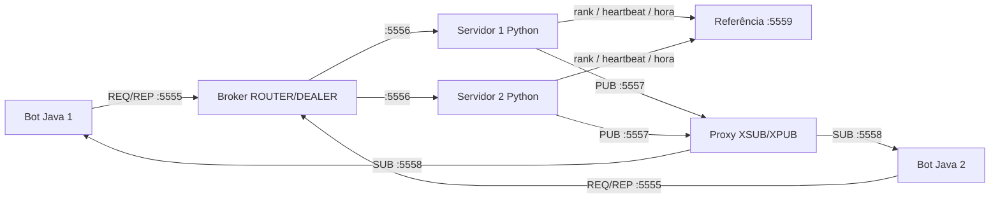

# FEI – Sistemas Distribuídos: sistema de troca de mensagens instantâneas

Projeto da disciplina de Sistemas Distribuídos. O sistema implementa bots que fazem login, criam/listam canais e publicam mensagens, com comunicação ZeroMQ, serialização binária MessagePack e persistência SQLite. Esta versão contempla as Partes 1, 2 e 3.

## Execução

```bash
docker compose up --build
```

O Compose inicia um broker, um proxy Pub/Sub, um serviço de referência, dois servidores Python e dois bots Java. Para encerrar, use `Ctrl+C` e `docker compose down`.

Os bancos SQLite permanecem em `data/server-1/` e `data/server-2/`, em volumes separados. Para reiniciar os dados do zero, pare os containers e remova essas pastas.

## Arquitetura



| Serviço | Função |
|---|---|
| `broker` | Encaminha requisições dos bots para os servidores usando ROUTER/DEALER. |
| `proxy` | Encaminha publicações dos servidores aos clientes inscritos, usando XSUB/XPUB. |
| `reference` | Atribui ranks, mantém a lista de servidores disponíveis, recebe heartbeats e fornece o horário de referência. |
| `server-1` e `server-2` | Processam login, canais e publicações; cada um mantém seu SQLite próprio. |
| `client-1` e `client-2` | Bots Java que fazem login, assinam canais e publicam mensagens continuamente. |

## Linguagens e bibliotecas

- **Python 3.12:** broker, proxy, servidores, serviço de referência e cliente Python de referência.
- **Java 21:** bots executados pelo Compose, usando JeroMQ.
- **ZeroMQ:** padrões REQ/REP, ROUTER/DEALER e PUB/SUB.
- **MessagePack:** serialização binária interoperável entre Java e Python.
- **SQLite:** persistência independente por servidor.

O broker e o proxy não interpretam nem alteram os envelopes; apenas encaminham os frames, preservando a comunicação binária.

## Formato das mensagens – MessagePack

Todas as mensagens de aplicação usam o mesmo envelope MessagePack:

| Campo | Tipo | Significado |
|---|---|---|
| `service` | string | Operação solicitada (`login`, `channel`, `channels`, `publish`, `rank`, `list`, `heartbeat` etc.). |
| `timestamp` | número | Timestamp físico de envio, em segundos desde Unix epoch. |
| `logical_clock` | inteiro | Contador lógico de Lamport do processo remetente. |
| `data` | mapa | Dados específicos da operação. |

Nas publicações PUB/SUB, o primeiro frame é o tópico UTF-8 (nome do canal) e o segundo frame é o envelope MessagePack com os mesmos campos obrigatórios.

### Relógio lógico (Lamport)

Cada bot e cada servidor inicia seu contador em zero. Antes de enviar uma mensagem, incrementa o contador e inclui o novo valor em `logical_clock`. Ao receber uma mensagem, atualiza seu contador para `max(contador_local, contador_recebido)`, conforme a regra definida no enunciado. A regra é aplicada tanto às mensagens REQ/REP quanto às publicações recebidas/enviadas e às mensagens trocadas com o serviço de referência.

O contador do bot Java é sincronizado entre a thread principal (REQ/REP) e a thread que recebe publicações SUB. O cliente Python também mantém um contador compartilhado entre essas operações.

## Serviço de referência, ranks e heartbeat

O novo container `reference` atende na porta TCP `5559` e usa o mesmo envelope MessagePack.

| Serviço | Requisição (`data`) | Resposta (`data`) |
|---|---|---|
| `rank` | `{name}` | `{status, rank}` |
| `list` | `{}` | `{status, servers:[{name, rank}, ...]}` |
| `heartbeat` | `{name, rank}` | `{status, reference_time, servers:[...]}` |

Ao iniciar, cada servidor envia `rank` com seu nome. A referência atribui um inteiro sequencial e não cria outro registro para um nome já conhecido. O rank é estável durante a execução do serviço de referência.

A cada 10 requisições recebidas de clientes, o servidor envia um `heartbeat`. A referência atualiza o instante de último contato e devolve `reference_time`, que o servidor usa para calcular a diferença entre o horário de referência e seu relógio local. Como containers normalmente não possuem privilégio para alterar o relógio do sistema operacional, o servidor aplica essa diferença como **offset físico interno** aos timestamps que gera; isso sincroniza os timestamps da aplicação sem tentar alterar o relógio do host.

A lista de disponíveis contém somente servidores que enviaram heartbeat dentro do timeout configurado (`HEARTBEAT_TIMEOUT`, padrão de 30 segundos). Servidores expirados são removidos da lista de disponíveis; o registro do nome/rank é mantido para que o rank não seja reutilizado. O serviço `list` retorna os nomes e ranks atualmente disponíveis.

> O heartbeat é disparado pela contagem de requisições de clientes, conforme solicitado. Portanto, se um servidor ficar sem receber requisições, ele não envia heartbeat nesse intervalo e poderá expirar da lista de disponíveis.

## Parte 1 – login e canais

- `login`: valida usuário (1–32 caracteres alfanuméricos, `_`, `-` ou `.`) e registra o timestamp no SQLite.
- `channel`: cria canais com nomes de 1–32 caracteres minúsculos, números, `_` ou `-`; duplicatas são rejeitadas.
- `channels`: retorna os nomes dos canais registrados naquele servidor.
- Cada servidor mantém seu banco próprio em `data/<nome-do-servidor>/`.

## Parte 2 – publicação e inscrição

O cliente pode assinar múltiplos tópicos no socket SUB. O servidor recebe `publish`, persiste a mensagem e publica no tópico igual ao nome do canal. A publicação inclui o usuário, o texto, o servidor, o timestamp original do cliente e o relógio lógico do cliente. O bot imprime canal, mensagem, timestamp de envio e timestamp de recebimento.

Os bots mantêm o comportamento automatizado do enunciado: garantem pelo menos cinco canais (criando um quando necessário), fazem inscrição até três canais e publicam em lotes de dez mensagens com intervalo de um segundo.

## Persistência

Cada servidor mantém um arquivo SQLite separado com as tabelas:

- `logins`: usuário e timestamp do login;
- `canais`: nome, criador e timestamp de criação;
- `mensagens`: canal, usuário, texto, timestamp de envio do cliente e timestamp de publicação do servidor.

## Estrutura de arquivos

```text
├── Dockerfile
├── docker-compose.yaml
├── README.md
├── requirements.txt
├── data/
│   ├── server-1/server-1.db
│   └── server-2/server-2.db
├── python/
│   ├── broker.py
│   ├── proxy.py
│   ├── common.py
│   ├── server.py
│   ├── reference.py
│   └── client.py
└── java/
    ├── Dockerfile
    ├── pom.xml
    └── src/main/java/br/fei/sistdist/ClientBot.java
```

## Observações

- O broker (`python/broker.py`) e o proxy (`python/proxy.py`) foram mantidos sem alterações funcionais nesta etapa.
- A sincronização física implementada é por offset de aplicação, pois alterar o relógio do sistema dentro de um container não é uma operação disponível sem privilégios adicionais.
- Os bancos dos servidores são independentes, conforme a especificação das partes anteriores; não há replicação de canais entre eles.
