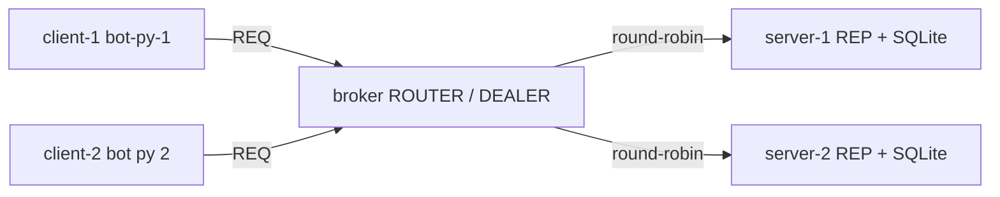

# FEI – Sistemas Distribuídos: Sistema de troca de mensagens instantâneas

Projeto da disciplina de Sistemas Distribuídos: uma versão simplificada de um sistema
estilo BBS/IRC em que **bots** (clientes) se conectam a **servidores**, fazem login e
criam/listam canais públicos. Toda a comunicação usa **ZeroMQ**, tudo roda em
**containers** orquestrados por Docker Compose e não há interação humana.

> **Status: Parte 1** – login de usuário, criação e listagem de canais, persistência em disco.
> (Publicação de mensagens nos canais virá nas próximas partes.)

## Como executar

```bash
docker compose up --build
```

Sobe 1 broker, 2 servidores e 2 clientes (bots). Os clientes rodam continuamente,
e cada envio/recebimento é exibido no terminal com todo o conteúdo da mensagem.
Para encerrar: `Ctrl+C` e `docker compose down`.

Os bancos de cada servidor ficam em `./data/server-1/` e `./data/server-2/`
(persistem entre execuções; apague a pasta para começar do zero).

## Arquitetura



| Componente | Padrão ZeroMQ | Função |
|---|---|---|
| `broker` | `ROUTER` (porta 5555, clientes) + `DEALER` (porta 5556, servidores) | Recebe as requisições dos clientes e as distribui entre os servidores conectados; devolve a resposta ao cliente correto. |
| `server` | `REP` conectado ao broker | Valida e processa login/canais, grava em disco e responde. |
| `client` | `REQ` conectado ao broker | Bot que faz login e cria/lista canais. |

Como os servidores apenas *conectam* no broker, é possível adicionar ou remover
servidores sem parar o serviço (o DEALER passa a distribuir também para o novo servidor).

## Escolhas de projeto

### Linguagem
**Python 3.12** para broker, servidor e cliente nesta parte (`python/`).
O formato de mensagem é independente de linguagem, então novos clientes/servidores em
outras linguagens poderão ser adicionados (ver *Próximos passos*).

### Serialização – MessagePack
Todas as mensagens são serializadas em binário com **MessagePack** (sem JSON/XML/texto).
Escolhido por ser simples (sem arquivo de esquema/compilador) e ter bibliotecas em
praticamente todas as linguagens. Envelope de todas as mensagens:

| Campo | Tipo | Descrição |
|---|---|---|
| `service` | string | `login`, `channel` ou `channels` |
| `timestamp` | float | Instante do envio (epoch, em segundos) – **obrigatório** |
| `data` | mapa | Conteúdo específico do serviço |

### Protocolo (padrão requisição/resposta)

| Serviço | `data` da requisição | `data` da resposta |
|---|---|---|
| `login` | `{user}` | `{status, server, user}` ou `{status:"erro", description}` |
| `channel` (criar) | `{user, channel}` | `{status, server, channel}` ou `{status:"erro", description}` |
| `channels` (listar) | `{user}` | `{status, server, channels:[nomes...]}` |

`status` é `"sucesso"` ou `"erro"`. Cada requisição gera exatamente uma resposta.

### Tratamento de erros
- **Login**: erro se o nome for vazio/inválido (1–32 caracteres: letras, números, `_`, `-`, `.`).
  Em caso de erro o bot **repete o login** com o nome corrigido (espaços/símbolos viram `-`).
  O `client-2` usa o nome `"bot py 2"` (inválido de propósito) para demonstrar isso.
  Logins repetidos do mesmo usuário são aceitos (cada um é registrado).
- **Criação de canal**: erro se o nome for inválido (1–32 caracteres minúsculos: `a-z`, `0-9`, `_`, `-`)
  ou se o canal **já existir** (nomes duplicados não são permitidos).
- **Mensagens malformadas** (não-MessagePack, sem timestamp, serviço desconhecido) recebem resposta
  de erro; o servidor nunca cai por causa de uma mensagem ruim.
- **Serviço indisponível**: se o bot não receber resposta em 3 s, recria o socket e reenvia
  (assim os clientes podem subir antes dos servidores).

### Critério do bot para criar canais
A cada rodada o bot lista os canais; se houver menos de 4 canais (ou com 25% de chance, para variar)
escolhe, de um conjunto de nomes, um que ainda não esteja na lista e tenta criá-lo.

### Persistência – SQLite
Cada servidor tem **o seu próprio arquivo** `<SERVER_NAME>.db` (volume exclusivo, não compartilhado),
com duas tabelas:
- `logins(id, usuario, timestamp)` – todos os logins, com o timestamp de envio;
- `canais(nome PRIMARY KEY, criado_por, timestamp)` – todos os canais criados.

SQLite foi escolhido por garantir unicidade dos canais e durabilidade sem dependências extras.
Ao reiniciar, o servidor mostra quantos logins/canais já tinha.

## Estrutura

```
├── README.md
├── Dockerfile              # imagem Python usada por todos os serviços
├── docker-compose.yaml     # broker + 2 servidores + 2 clientes
├── requirements.txt        # pyzmq, msgpack
├── python/
│   ├── common.py           # envelope, (de)serialização, validações e log formatado
│   ├── broker.py
│   ├── server.py
│   └── client.py
└── data/                   # bancos SQLite (um por servidor)
```

## Limitações conhecidas / próximos passos
- Como **cada servidor mantém dados próprios** (exigência da parte 1) e o broker distribui em
  round-robin, a lista de canais retornada pode variar conforme o servidor que atende. A sincronização
  entre servidores (replicação) fica para as próximas partes.
- Para a entrega final, o enunciado exige **pelo menos 2 linguagens** em projeto individual
  (e uma a mais por integrante). Falta adicionar clientes/servidores em outra linguagem, que
  deverão seguir o mesmo envelope MessagePack acima.
